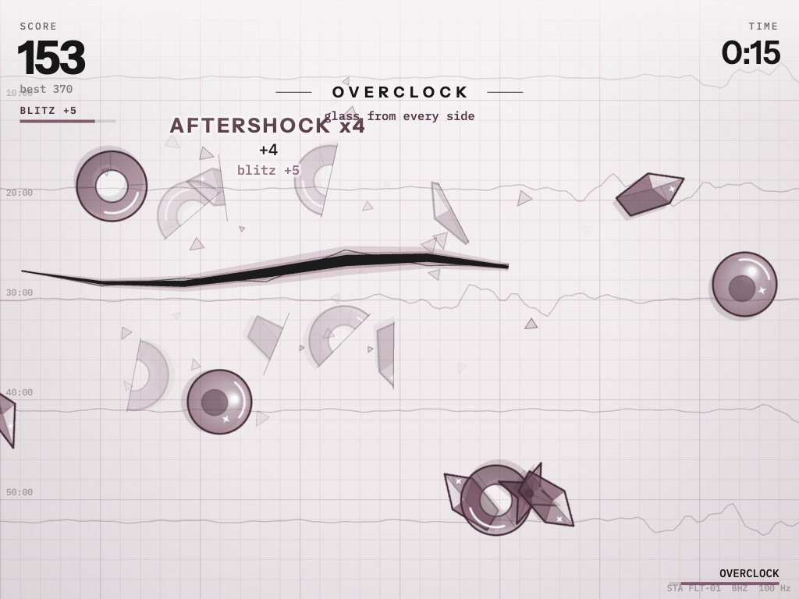

# Fault Line

A glass-slicing arcade game for the Seismic community. The screen is a
seismogram and your swipe is the fault line drawn on it: glass is tossed across
the chart, you shatter it, and you never cut what is shielded. Plays on phones
(portrait or landscape) and on desktop.

It is its own game: its own look (chart paper, ink, stained glass), its own
objects, its own sound and score. Nothing is shared with Magnitude Run.

Fan-made. Not an official Seismic product. No wallet, no account.



## Play

- **Swipe** (touch, or hold the left mouse button) through anything made of
  glass: Orbs, Lenses, Prisms, Darts, and Stars (worth two). Two fingers work.
- **Three or more in one swipe** is an aftershock and pays its size again.
  Aftershocks in quick succession build the **blitz**: every third one raises
  the tier, and each aftershock then pays tier × 5 on top. Three seconds
  without one and the chain drops.
- A cut close to the centre of a target is a **clean cut**, worth one more.
- **Shielded blocks** (solid ink squares with a padlock, like a redaction
  bar) must not be cut.
  In Arcade it costs 10 points, clears the screen and cancels your blitz and
  powers. In Classic it costs a crack.
- **Hexagons** are powers, cut them to trigger: Overclock (glass pours in
  from both sides), Amplifier (everything counts double), Stasis (time slows
  and the clock stops), Quake (everything on screen shatters).
- **Esc / P** or the button at the top pauses. **M** mutes.

### Modes

| mode | rules |
| --- | --- |
| Arcade | 60 seconds, no penalty for a miss. At zero the Core rises: cut it as many times as you can. Up to three end-of-round bonuses. |
| Classic | No clock. A missed target or a cut block is a crack; three cracks end it. Every 100 points repairs one. |
| Daily | Arcade on one course for everyone, seeded by the server each UTC day, with its own board. Every wave is drawn from the seed and the wave number alone, so how you play cannot change what comes next. |

Missions (three at a time, 36 in all) raise a rank from Magnitude 1.0 to 9.0
and unlock blade colours.

## Run locally

Static files, no build step. The local server also runs the leaderboard API
against an in-memory store, so the online flow works without Vercel:

```bash
node serve.mjs 5174
```

Then open http://127.0.0.1:5174/. To try it on a phone on the same network,
serve on your LAN address or deploy a preview. URL flags: `?nopause=1` keeps
the round running when the tab loses focus, `?pwa=1` enables the service
worker on localhost, `?debug=1` exposes the game as `window.__fl`.

```bash
npm test
```

runs a headless smoke test: the real loop with a swiping bot, checking for
exceptions, NaNs, runaway object counts, that rounds end, that a seed gives
the same course, and that the server rules accept an honest round.

## Deploy on Vercel

1. Import the repository (framework preset: Other, no build command).
2. Storage → Marketplace → **Upstash Redis**, attach it to the project. The
   same database as Magnitude Run is fine: every key here starts with `fl:`.
3. Add `RUN_SECRET`, a long random string (`openssl rand -hex 32`).
4. Deploy. Without Redis the game still runs and keeps scores in the browser.

### API

| endpoint | purpose |
| --- | --- |
| `POST /api/start` | signed, single-use token carrying the start time, and the day's seed |
| `POST /api/submit` | plausibility checks, then the best score per player id on that board |
| `GET /api/board?board=arcade\|classic\|daily` | top list and your own rank |

The checks are for honest players (round length, score against what the
counts could have paid, single-use tokens, rate limits). The round is played
in the browser, so a determined cheat can still post a believable score.

## How it is built

| file | what |
| --- | --- |
| `src/game.js` | loop, wave spawner, physics, cutting, combos and blitz, powers, the Core, HUD |
| `src/targets.js` | every tossed object, drawn once and cached as a sprite |
| `src/blade.js` | the stroke: a tapered ribbon of ink with a seismograph line riding it; segment tests |
| `src/paper.js` | the chart: ruled paper and live pen traces that react to shakes and quakes |
| `src/input.js` | Pointer Events, raw and coalesced samples, two blades |
| `src/audio.js`, `src/music.js` | struck-glass bells, skin and wood drums, a plucked line in A Hirajoshi; the drum kit grows with the blitz |
| `src/missions.js` | missions, rank, blade unlocks |
| `src/card.js` | 1200×630 share card |
| `api/` | Vercel functions |

Notes from the research that shaped it: one point per target and combo = size
(the Fruit Ninja economy), about two seconds of hang time, glass hit boxes
larger than the art and shielded ones smaller, no blocks in the first six
seconds or during Overclock, a blade that only cuts while it is moving, and
samples taken from every pointer event rather than once per frame.

## Brand

Colours come from the Seismic Brand Kit v2 (Mauve `#825A6D`, Purple `#523542`,
ink `#161616` on a paper white), set in Instrument Sans with IBM Plex Mono for
the chart annotations.
