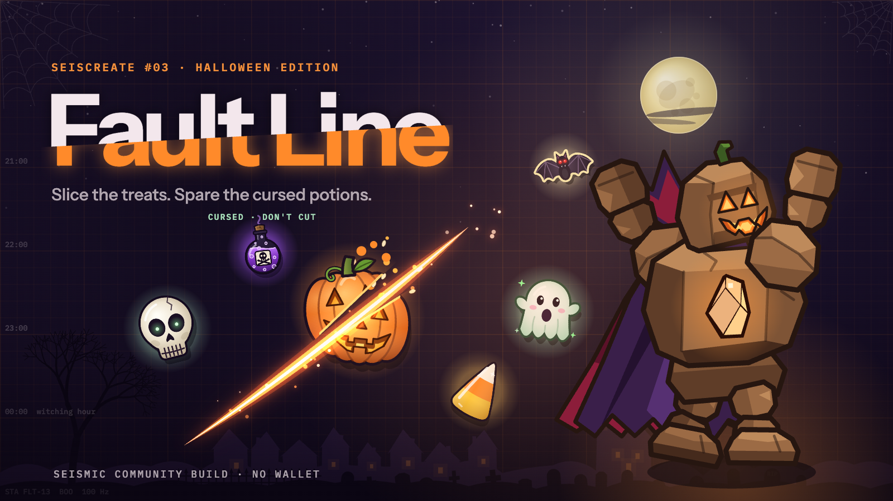

# Fault Line: Halloween edition

A slicing arcade game for the Seismic community, made for SEISCREATE #03
(#ROCKYHalloween). The screen is a seismogram on a haunted night: treats are
tossed across the chart, your swipe cuts them, and you never cut a cursed
potion. Jack-o'-Rocky, the Seismic mascot in costume, hosts. Plays on phones
(portrait or landscape) and on desktop.

Fan-made. Not an official Seismic product. No wallet, no account.



## What's in it

- **Night sheet**: a night sky with a full moon, cobwebs, a haunted skyline,
  graves, bats and fog. The pen traces glow ghost green.
- **Treats**: Pumpkins, Skulls, Candy Corn, Bats and Ghosts (worth two).
- **Cursed potions**: purple flasks with a skull label. Don't cut them.
- **Powers**: Witching Hour, Double Treat, Frozen Time and Haunt.
- **The Great Pumpkin** rises at the end of each Arcade round.
- **Jack-o'-Rocky**: a carved jack-o'-lantern face, an ember in his chest and
  a vampire cape. He waves on the title, stands in the corner during a round,
  cheers your aftershocks and flinches when you cut a potion.
- **Glowing blades**: Ember, Witch Purple, Candy Stripe, Bone, Ectoplasm.
- **Music and sound**: a music-box waltz on the title, a skeleton dance with
  theremin and organ during play, a heavier piece for The Great Pumpkin, and
  sound effects to match (juicy chops, a witch's cackle, a wolf howl).
- The share card and share text carry **#ROCKYHalloween**.

## Play

- **Swipe** (touch, or hold the left mouse button) through the treats. Two
  fingers work.
- **Three or more in one swipe** is an aftershock and pays its size again.
  Aftershocks in quick succession build the **blitz**: every third one raises
  the tier, and each aftershock then pays tier × 5 on top. Three seconds
  without one and the chain drops.
- A cut close to the centre of a treat is a **clean cut**, worth one more.
- **Cursed potions** must not be cut. In Arcade a cut costs 10 points, clears
  the screen and cancels your blitz and powers. In Classic mode it costs a
  crack.
- **Power-ups** trigger when you cut them: Witching Hour (treats pour in from
  both sides), Double Treat (everything counts double), Frozen Time (time
  slows and the clock stops), Haunt (everything on screen shatters).
- **Esc / P** or the button at the top pauses. **M** mutes.

### Modes

| mode | rules |
| --- | --- |
| Arcade | 60 seconds, no penalty for a miss. At zero The Great Pumpkin rises: cut it as many times as you can. Up to three end-of-round bonuses. |
| Classic | No clock. A missed treat or a cut potion is a crack; three cracks end it. Every 100 points repairs one. |
| Daily | Arcade on one course for everyone, seeded by the server each UTC day, with its own board. Every wave is drawn from the seed and the wave number alone, so how you play cannot change what comes next. |

Missions (three at a time, 36 in all) raise a rank from Magnitude 1.0 to 9.0
and unlock blades.

## Run locally

Static files, no build step. The local server also runs the leaderboard API
against an in-memory store, so the online flow works without Vercel:

```bash
node serve.mjs 5174
```

Then open http://127.0.0.1:5174/. URL flags: `?nopause=1` keeps the round
running when the tab loses focus, `?pwa=1` enables the service worker on
localhost, `?debug=1` exposes the game as `window.__fl`.

```bash
npm test
```

runs a headless smoke test: the real loop with a swiping bot, checking for
exceptions, NaNs, runaway object counts, that rounds end, that a seed gives
the same course, and that the server rules accept an honest round.

## Deploy on Vercel

1. Import the repository (framework preset: Other, no build command).
2. Storage → connect an **Upstash Redis** database to the project. Magnitude
   Run's database is fine: every key here starts with `fl:`.
3. Optional: add `RUN_SECRET`, a long random string (`openssl rand -hex 32`).
   Without it the server signs with the Redis token.
4. Deploy. Without Redis the game still runs and keeps scores in the browser.

### API

| endpoint | purpose |
| --- | --- |
| `POST /api/start` | signed, single-use token carrying the start time, and the day's seed |
| `POST /api/submit` | plausibility checks, then the best score per player id on that board |
| `GET /api/board?board=arcade\|classic\|daily` | top list and your own rank |

The checks are for honest players (round length, score against what the
counts could have paid, single-use tokens, rate limits). The round is played
in the browser, so a determined cheat can still post a believable score.

## How it is built

| file | what |
| --- | --- |
| `src/game.js` | loop, wave spawner, physics, cutting, combos and blitz, powers, The Great Pumpkin, HUD |
| `src/targets.js` | every tossed treat and potion, drawn once and cached as a sprite |
| `src/blade.js` | the glowing blade and its segment tests |
| `src/paper.js` | the night sheet and live pen traces that react to shakes and quakes |
| `src/rocky.js` | Jack-o'-Rocky, drawn in code, and the host that reacts to play |
| `src/theme.js` | the Halloween palette and names |
| `src/input.js` | Pointer Events, raw and coalesced samples, two blades |
| `src/audio.js`, `src/music.js` | music and sound effects, built live with Web Audio |
| `src/missions.js` | missions, rank, blade unlocks |
| `src/card.js` | 1200×630 share card |
| `design/halloween.html` | redraws the posters (`halloween-wide.png`, `halloween-square.png`) from the game's code |
| `api/` | Vercel functions |

Notes from the research that shaped it: one point per target and combo = size
(the Fruit Ninja economy), about two seconds of hang time, hit boxes larger
than the art for treats and smaller for potions, no potions in the first six
seconds or during Witching Hour, a blade that only cuts while it is moving,
and samples taken from every pointer event rather than once per frame.
